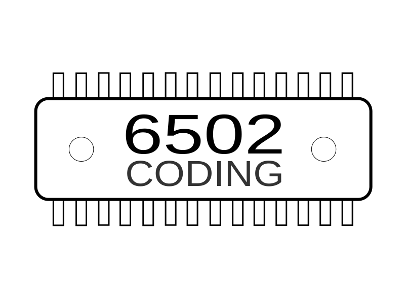
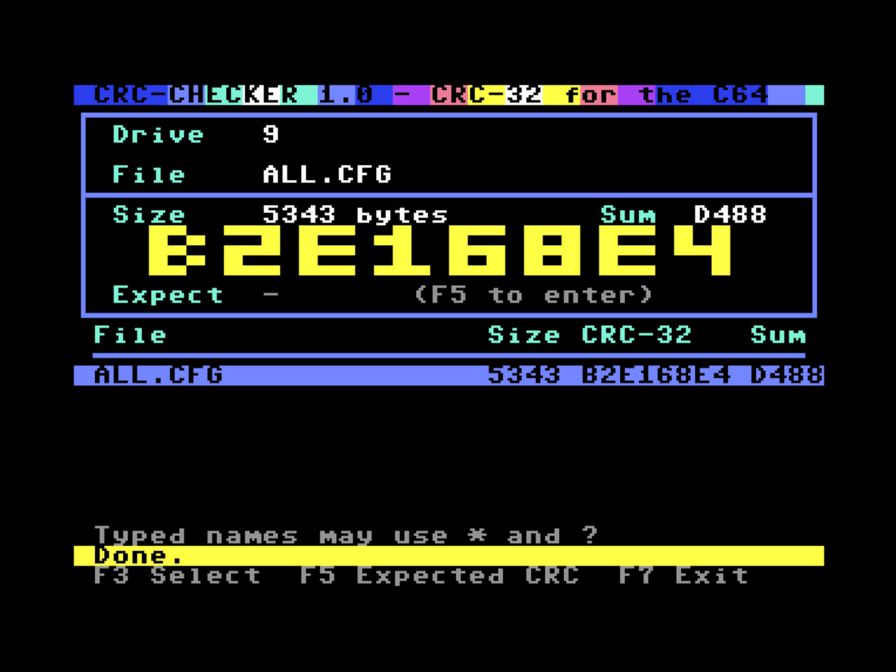
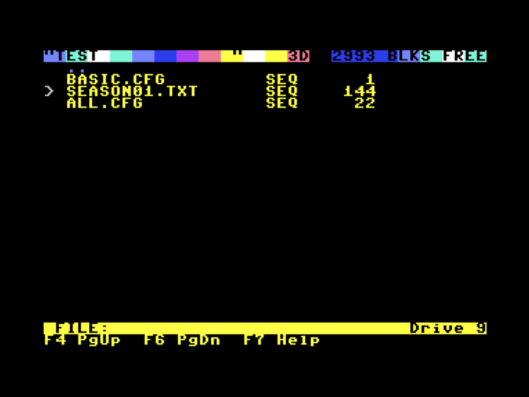
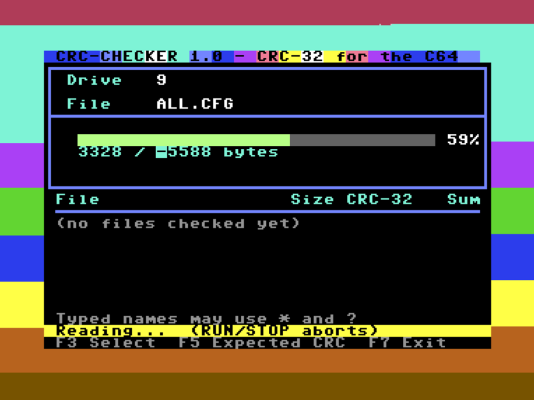
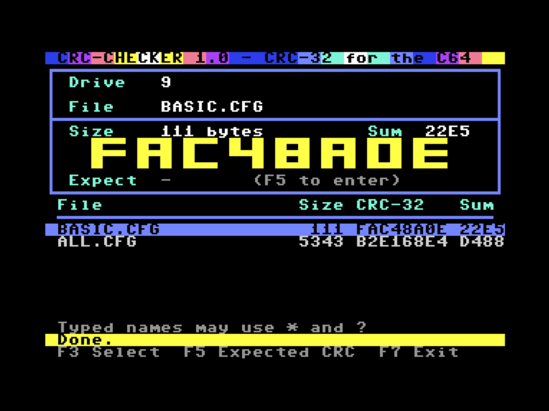

  

# C64 CRC Checker
Calculates CRC checksums for files on the C64

  

  

  

  
  
A great-looking CRC32 checksum tool for the C64.  
Checksums are displayed in a history, making it easy to compare values or check them against a checksum file provided by the publisher. This helps you verify that a download arrived complete and without transmission errors.  

    
   
   
     
> [!Important]
>**AI Notice:**  
>The code was created with the assistance of Claude.  
   
